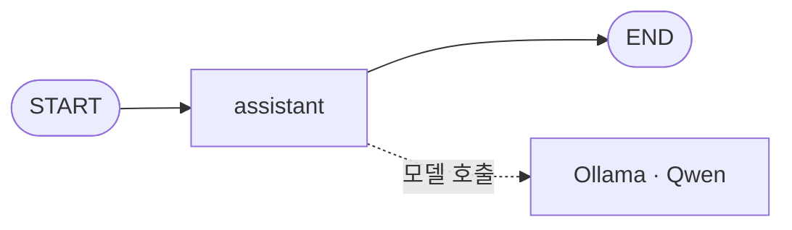

<p align="center">
  
</p>

<p align="center">
  <a href="https://www.python.org/"></a>
  <a href="https://github.com/langchain-ai/langgraph"></a>
  <a href="https://ollama.com/"></a>
</p>

<p align="center">
  <strong>로컬 LLM과 작은 그래프로 시작하는 에이전트 프로젝트.</strong><br>
  실행 코드를 읽고 · 직접 돌려 보고 · 강의 슬라이드로 정리합니다.
</p>

<p align="center">
  <a href="docs/usage.md">실행 가이드</a> ·
  <a href="docs/architecture.md">동작 구조</a> ·
  <a href="docs/slides.md">슬라이드</a> ·
  <a href="https://github.com/scpark20/SteSlide">SteSlide</a>
</p>

---

## Hello world부터

현재는 질문을 받아 로컬 모델을 한 번 호출하고 답을 출력하는 최소 구현입니다.



| 구성 | 역할 |
| --- | --- |
| **LangGraph** | 상태와 실행 순서를 그래프로 표현합니다. |
| **Ollama · Qwen** | 로컬에서 모델을 구동하고 응답을 생성합니다. |
| **SteSlide** | 강의 Markdown을 합쳐 실시간 슬라이드로 보여 줍니다. |

## 빠른 시작

**Python 3.11+ · [uv](https://docs.astral.sh/uv/getting-started/installation/) · [Ollama](https://ollama.com/download)**가 필요합니다. Ollama를 실행한 상태에서 진행하세요.

```bash
git clone --recurse-submodules https://github.com/scpark20/SteAgent.git
cd SteAgent
ollama pull qwen3:4b-instruct
uv sync --locked
uv run agent.py "안녕! 2 + 3은 얼마야?"
```

기본 모델은 [Qwen3 4B Instruct](https://ollama.com/library/qwen3:4b-instruct)입니다. 모델 변경, 연결 설정과 오류 해결은 [실행 가이드](docs/usage.md)에서 확인할 수 있습니다.

## 강의 슬라이드

[SteSlide](https://github.com/scpark20/SteSlide)를 서브모듈로 받아 사용합니다. 프로젝트 루트에서:

```bash
python3 tools/steslide/scripts/setup_marp.py
bash lectures/preview.sh
```

**[localhost:8766/lecture.md](http://localhost:8766/lecture.md)**에서 미리보기를 엽니다. 강의는 **LLM → Ollama → LangGraph** 순서로 구성하며, 각 Chapter는 **Hello World!!!**로 시작합니다. 현재는 제목만 준비되어 있습니다. 원본은 `lectures/`에 있습니다. 편집·내보내기·업데이트 절차는 [슬라이드 가이드](docs/slides.md)에 있습니다.

## 문서

- [실행 가이드](docs/usage.md) — 설치, 모델 선택, 환경변수, 문제 해결
- [동작 구조](docs/architecture.md) — 상태, 노드, 모델 호출과 현재 구현 범위
- [슬라이드 가이드](docs/slides.md) — 강의 편집과 SteSlide 연동

Powered by [LangGraph](https://github.com/langchain-ai/langgraph), [Ollama](https://github.com/ollama/ollama) and [SteSlide](https://github.com/scpark20/SteSlide).
