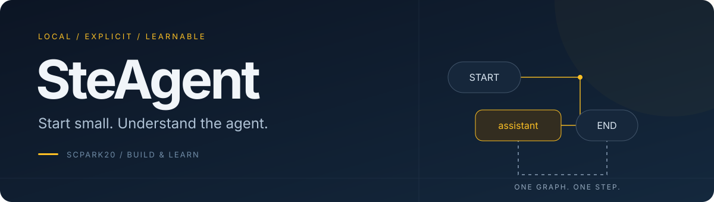

<p align="center">
  
</p>

<p align="center">
  <a href="https://www.python.org/"></a>
  <a href="https://github.com/langchain-ai/langgraph"></a>
  <a href="https://ollama.com/"></a>
</p>

<p align="center">
  <strong>Build an agent one small code change at a time.</strong><br>
  Read the code · Run it locally · Build the lesson alongside it
</p>

<p align="center">
  <a href="docs/usage.md">Getting started</a> ·
  <a href="docs/curriculum.md">Course outline</a> ·
  <a href="docs/architecture.md">Architecture</a> ·
  <a href="docs/slides.md">Slides</a>
</p>

---

## Run the agent

The final implementation chooses a tool, executes it, observes its result, and responds. It includes argument validation, error observations, and a model-call limit.

```bash
git clone --recurse-submodules https://github.com/scpark20/SteAgent.git
cd SteAgent
ollama pull qwen3:4b-instruct
uv sync --locked
uv run agent.py "Use add to calculate 12 + 30." --trace
```

Requires **Python 3.11+, [uv](https://docs.astral.sh/uv/), and a running [Ollama](https://ollama.com/)**.

```text
[tool:add] {"result": 42}
12 + 30 = 42.
```

The wording of the final model response can vary. The tool result is computed by Python.

## Eight runnable chapters

Start with **Hello World!!!** from pretrained weights, then add HTTP inference, state, tool execution, and feedback. Each checkpoint explains its actual source and records the changes from the previous one.

| Chapter | Runnable code | What changes |
| --- | --- | --- |
| 01 · LLM | [agent.py](code/chapter-01/agent.py) | Load pretrained weights and generate directly. |
| 02 · Ollama | [agent.py](code/chapter-02/agent.py) | Replace the model call with HTTP. |
| 03 · LangGraph | [agent.py](code/chapter-03/agent.py) | Wrap the same call in a graph node. |
| 04 · State & Memory | [agent.py](code/chapter-04/agent.py) | Retain messages between turns. |
| 05 · Tools | [agent.py](code/chapter-05/agent.py) | Add a function, schema, registry, and executor. |
| 06 · Tool Calling | [agent.py](code/chapter-06/agent.py) | Let the model request one tool execution. |
| 07 · Agent Loop | [agent.py](code/chapter-07/agent.py) | Feed the tool result back to the model. |
| 08 · Minimal Agent | [agent.py](code/chapter-08/agent.py) | Add validation, error handling, and bounded execution. |

The root `agent.py` runs Chapter 08. Each chapter is a standalone checkpoint of the same evolving program. Chapters 02–08 include a `changes.diff` against their predecessor.

## Start with direct inference

Chapter 01 runs without Ollama or LangGraph. Its optional dependencies are installed with:

```bash
uv sync --locked --extra llm
uv run --extra llm code/chapter-01/agent.py
```

The default model is `Qwen/Qwen3-4B-Instruct-2507`. Set `LLM_MODEL` to use another supported model or an existing local checkpoint. See the [usage guide](docs/usage.md) for GPU and FP8 details.

## Read code as slides

```bash
python3 tools/steslide/scripts/setup_marp.py
bash lecture/preview.sh
```

Open **[localhost:8766/lecture.md](http://localhost:8766/lecture.md)**. The 19-slide lecture places source code beside explanations, execution diagrams, tables, and equations. Code excerpts are extracted directly from the Python files and update when those files change.

## Documentation

- [Usage guide](docs/usage.md) — Run every checkpoint and the final agent
- [Course outline](docs/curriculum.md) — The progression and code changes
- [Architecture](docs/architecture.md) — Messages, nodes, tools, and stopping
- [Slide guide](docs/slides.md) — Edit the single lecture and update SteSlide

Powered by [LangGraph](https://github.com/langchain-ai/langgraph), [Ollama](https://github.com/ollama/ollama), and [SteSlide](https://github.com/scpark20/SteSlide).
