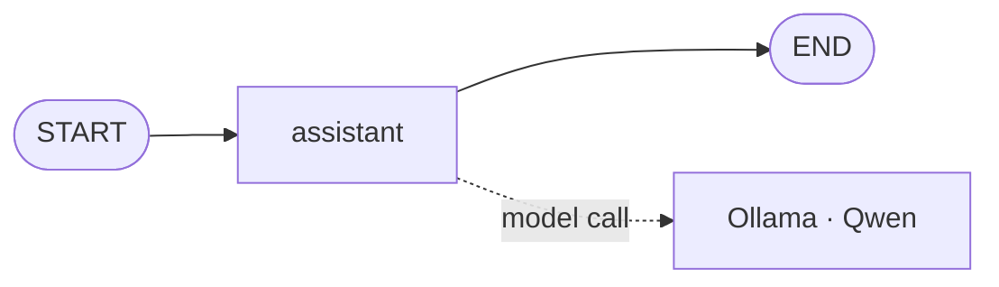

<p align="center">
  
</p>

<p align="center">
  <a href="https://www.python.org/"></a>
  <a href="https://github.com/langchain-ai/langgraph"></a>
  <a href="https://ollama.com/"></a>
</p>

<p align="center">
  <strong>Learn agents through a local model and a small, explicit graph.</strong><br>
  Read the code · Run it locally · Build the lesson alongside it
</p>

<p align="center">
  <a href="docs/usage.md">Getting started</a> ·
  <a href="docs/curriculum.md">Course outline</a> ·
  <a href="docs/architecture.md">Architecture</a> ·
  <a href="docs/slides.md">Slides</a>
</p>

---

## Start with hello world

The current runnable example sends a question to a local model once and prints the answer.



| Component | Role |
| --- | --- |
| **LangGraph** | Represents state and execution order as a graph. |
| **Ollama · Qwen** | Runs the language model locally and generates a response. |
| **SteSlide** | Assembles lecture Markdown into a live presentation. |

## Quick start

Requires **Python 3.11+ · [uv](https://docs.astral.sh/uv/getting-started/installation/) · [Ollama](https://ollama.com/download)**. Start Ollama before running these commands:

```bash
git clone --recurse-submodules https://github.com/scpark20/SteAgent.git
cd SteAgent
ollama pull qwen3:4b-instruct
uv sync --locked
uv run agent.py "What is 2 + 3?"
```

The default model is [Qwen3 4B Instruct](https://ollama.com/library/qwen3:4b-instruct). See the [usage guide](docs/usage.md) for model selection, connection settings, and troubleshooting.

## One codebase, three chapters

**LLM → Ollama → LangGraph.** Each chapter starts with **Hello World!!!** and builds on the previous implementation with small, explicit changes.

The [course outline](docs/curriculum.md) starts with direct model inference and ends with a minimal tool-using agent. It is a teaching plan; the current runnable code remains the single-call LangGraph example above.

## Lecture slides

[SteSlide](https://github.com/scpark20/SteSlide) is included as a Git submodule. From the project root:

```bash
python3 tools/steslide/scripts/setup_marp.py
bash lectures/preview.sh
```

Open **[localhost:8766/lecture.md](http://localhost:8766/lecture.md)**. Sources live in `lectures/`; only chapter titles and opening section titles are currently populated. See the [slide guide](docs/slides.md) for editing, exporting, and updating the shared tool.

## Documentation

- [Usage guide](docs/usage.md) — Installation, model selection, and troubleshooting
- [Course outline](docs/curriculum.md) — A small-change path from inference to an agent
- [Architecture](docs/architecture.md) — State, nodes, model calls, and current scope
- [Slide guide](docs/slides.md) — Lecture editing and SteSlide integration

Powered by [LangGraph](https://github.com/langchain-ai/langgraph), [Ollama](https://github.com/ollama/ollama), and [SteSlide](https://github.com/scpark20/SteSlide).
