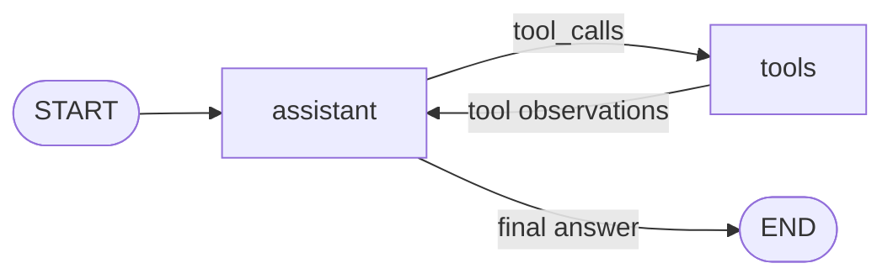

# Architecture

[← SteAgent](../README.md) · [Usage guide](usage.md) · [Course outline](curriculum.md)

## Final control flow

The root entry point executes `code/chapter-08/agent.py`. Earlier chapter files are runnable checkpoints of the same implementation, allowing direct source comparisons.

`call_model()` sends role/content messages and tool definitions to Ollama with Python's HTTP standard library. No LangChain model wrapper is required. `StateGraph` only manages execution and state.

## State and nodes

State contains `messages` and the number of model `calls` in the current turn. Each node returns the complete updated message list, so the graph uses replacement semantics rather than an append reducer.

The assistant node adds the model response. A conditional edge checks for `tool_calls`. The tools node dispatches registered functions and appends their observations. The next assistant call receives the request and result together.

The CLI keeps the returned state for `--chat`, appends the next user message, and resets the per-turn call counter.

## Tools and errors

The registry contains one tool, `add(a, b)`. Its JSON schema is sent to the model, but the Python function independently validates actual values. It rejects non-numeric values, booleans, non-finite inputs, and non-finite results.

Unknown tools, invalid arguments, and ordinary execution exceptions become JSON error observations. The dispatcher invokes only registered callables; it does not evaluate generated Python.

## Termination

A model response without tool calls ends the graph. If another action is requested after the allowed model-call count, execution stops before dispatching it. A final answer on the last allowed call is accepted. The CLI also sets a graph recursion limit and a 120-second HTTP timeout.

This is a minimal local agent: one tool, in-process message history, and bounded execution. It has no persistent memory, external application actions, or autonomous background tasks.
