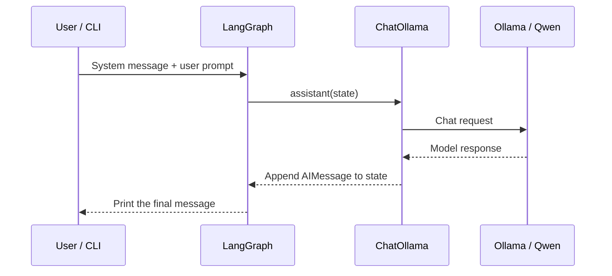

# Architecture

[← SteAgent](../README.md) · [Usage guide](usage.md) · [Slides](slides.md)

## One request

`build_graph()` in `agent.py` creates a `StateGraph` with `MessagesState`. Its path is `START → assistant → END`; `assistant` calls `ChatOllama.invoke()` once. `main()` reads CLI arguments, constructs the messages, invokes the graph, and prints the response.

The current implementation has no tool calls, planning loop, or persistent conversation memory. Each process invocation handles an independent question. The [course outline](curriculum.md) describes planned incremental steps beyond this hello-world baseline.

## Model settings

The `ChatOllama` constructor in `agent.py` currently sets:

| Option | Value | Purpose |
| --- | --- | --- |
| `temperature` | `0` | Reduce sampling randomness. |
| `reasoning` | `False` | Request non-thinking behavior when supported by the model. |
| `num_ctx` | `4096` | Configure the context size. |
| `num_predict` | `256` | Limit generated tokens. |
| `client_kwargs.timeout` | `120.0` | Configure the HTTP client timeout. |
| `validate_model_on_init` | `True` | Check model availability during initialization. |

Reasoning support depends on the model. Setting `reasoning=True` cannot add a thinking mode to a model that does not support one.

## Files

| File | Responsibility |
| --- | --- |
| `agent.py` | Graph definition and CLI entry point |
| `pyproject.toml`, `uv.lock` | Dependency declarations and pinned versions |
| `lectures/` | Lecture Markdown sources |
| `tools/steslide/` | Shared slide tooling as a Git submodule |
| `steslide.json` | Project slide settings |

Official references: [LangGraph](https://docs.langchain.com/oss/python/langgraph/overview), [ChatOllama](https://docs.langchain.com/oss/python/integrations/chat/ollama).
