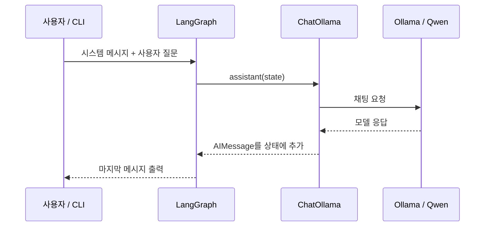

# 동작 구조

[← SteAgent](../README.md) · [실행 가이드](usage.md) · [슬라이드](slides.md)

## 한 번의 요청

`agent.py`의 `build_graph()`는 `MessagesState`를 사용하는 `StateGraph`를 만듭니다. 흐름은 `START → assistant → END`이며 `assistant`가 `ChatOllama.invoke()`를 한 번 호출합니다. `main()`은 명령줄 인자를 읽고 메시지를 만든 뒤 그래프를 실행합니다.

현재 구현에는 도구 호출, 반복 계획, 영속 대화 기억이 없습니다. 프로세스를 실행할 때마다 독립된 질문을 처리하는 Hello World 단계입니다.

## 모델 설정

`agent.py`의 `ChatOllama` 생성 부분에 다음 값이 지정되어 있습니다.

| 옵션 | 값 | 역할 |
| --- | --- | --- |
| `temperature` | `0` | 샘플링의 무작위성을 낮춥니다. |
| `reasoning` | `False` | 지원하는 모델에 사고 모드 비활성화를 요청합니다. |
| `num_ctx` | `4096` | 사용할 컨텍스트 크기를 지정합니다. |
| `num_predict` | `256` | 생성 토큰 수의 상한을 지정합니다. |
| `client_kwargs.timeout` | `120.0` | HTTP 클라이언트 타임아웃을 지정합니다. |
| `validate_model_on_init` | `True` | 초기화 시 서버에서 모델 존재 여부를 확인합니다. |

사고 모드 지원 여부는 모델에 따라 다릅니다. `reasoning=True`만으로 해당 기능이 없는 모델에 사고 모드를 추가할 수는 없습니다.

## 파일 역할

| 파일 | 역할 |
| --- | --- |
| `agent.py` | 그래프와 명령줄 실행 |
| `pyproject.toml`, `uv.lock` | 의존성 선언과 고정 |
| `lectures/` | 강의 Markdown 원본 |
| `tools/steslide/` | 슬라이드 공통 도구를 받는 서브모듈 |
| `steslide.json` | 이 프로젝트의 슬라이드 설정 |

관련 공식 문서: [LangGraph](https://docs.langchain.com/oss/python/langgraph/overview), [ChatOllama](https://docs.langchain.com/oss/python/integrations/chat/ollama).
